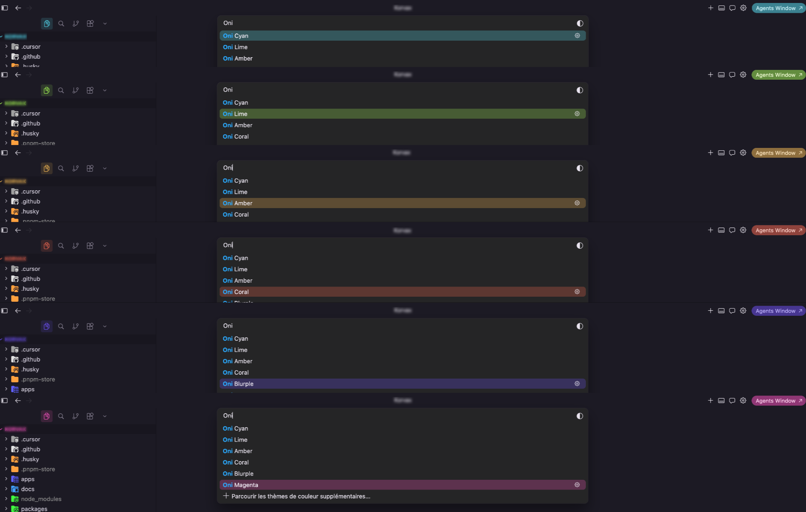

# Oni Themes

Dark themes for VS Code & Cursor — soft pastel dusk base, neon accent variants.

Based on / strongly inspired by [Bearded Theme](https://github.com/BeardedBear/bearded-theme) (Black & Gems) by [BeardedBear](https://github.com/BeardedBear), with a distinct dusk atmosphere and brighter neon accents.



## Themes

| Theme | Accent |
|-------|--------|
| **Oni Lime** | `#a8ff53` |
| **Oni Blurple** | `#7053ff` |
| **Oni Cyan** | `#53e8ff` |
| **Oni Magenta** | `#ff53c6` |
| **Oni Amber** | `#ffc053` |
| **Oni Coral** | `#ff6b53` |

Shared base: **Oni Dusk** — soft mauve charcoal. Syntax colors stay gem-like across all variants; only the UI accent changes.

## Install

### From a VSIX (recommended for Cursor)

1. Download the latest `.vsix` from [Releases](https://github.com/Onivoid/oni-themes/releases)
2. In Cursor / VS Code: **Extensions** → `⋯` → **Install from VSIX…**
3. Pick the file, then **Preferences: Color Theme** → choose an Oni variant

### From source (dev)

```bash
git clone https://github.com/Onivoid/oni-themes.git
cd oni-themes
pnpm install
```

Then press **F5** (Extension Development Host), or use **Developer: Install Extension from Location…**

## Usage

`Cmd+K Cmd+T` (Mac) / `Ctrl+K Ctrl+T` (Windows/Linux) → select **Oni Lime**, **Oni Blurple**, etc.

## Release

1. Bump `version` in `package.json` (e.g. `0.2.0`)
2. Commit, then tag and push:

```bash
git tag v0.2.0
git push origin v0.2.0
```

GitHub Actions (environment `openvsx`) will:
- package the `.vsix`
- publish it to [Open VSX](https://open-vsx.org/extension/onivoid/oni-themes) via [Trusted Publishing](https://github.com/eclipse-openvsx/openvsx/wiki/Trusted-Publishing)
- attach the `.vsix` to the GitHub Release

Trusted Publisher registration (Open VSX → Settings → Trusted Publishers):

| Field | Value |
|-------|--------|
| Owner | `Onivoid` |
| Repository | `oni-themes` |
| Workflow | `release.yml` |
| Environment | `openvsx` |

## License

[GPL-3.0](./LICENSE) © Onivoid

This project incorporates work derived from [Bearded Theme](https://github.com/BeardedBear/bearded-theme), © BeardedBear, licensed under the [GNU GPL v3](https://github.com/BeardedBear/bearded-theme/blob/master/LICENSE.txt).
